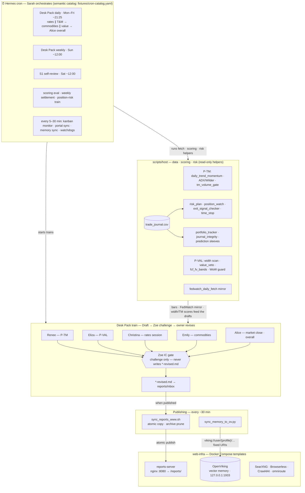
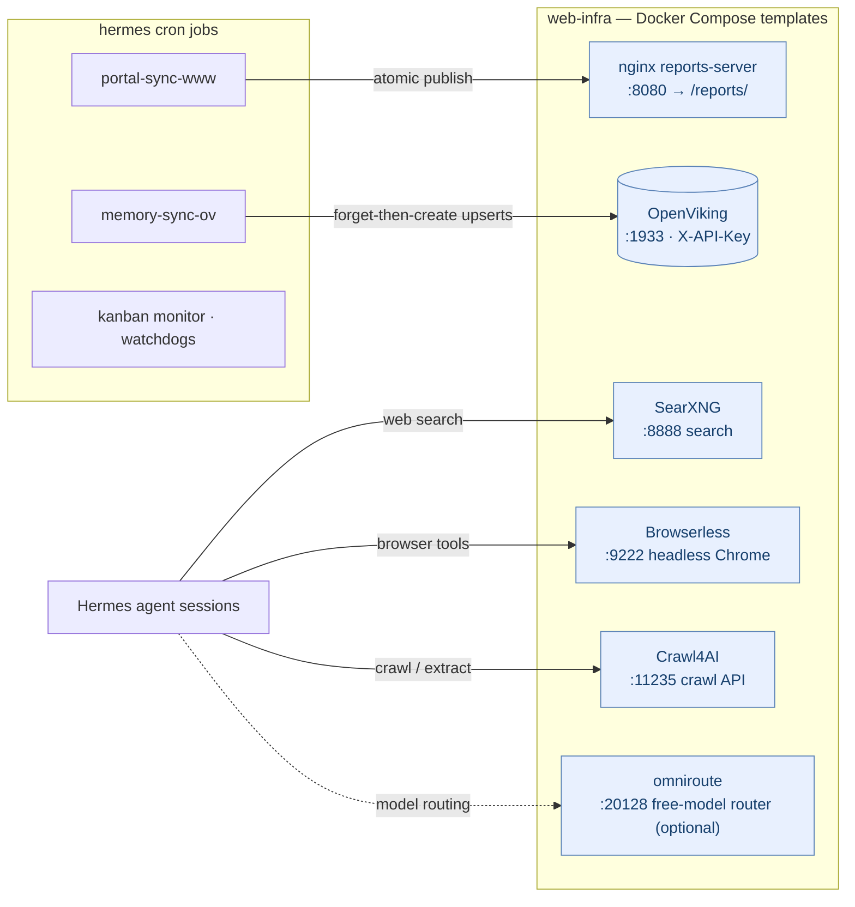

# Helios @ Hermes AI Agent

Multi-specialist **investment desk** for Hermes: trend/momentum (P-TM), value/width (P-VAL), rates, commodities, macro integrate — plus Docker templates for a reports portal, memory (OpenViking), web search, browserless, and crawl.

**Not investment advice.** Scripts read journals and market data; they do not place broker orders unless you wire that on your host.

## Install path (short)

```text
1. Hermes already installed
2. Bring up web-infra Docker (reports, OpenViking, SearXNG, Browserless, Crawl4AI)
3. Copy .env.example → .env ; set keys
4. Copy profiles + scripts/host → $HERMES_HOME
5. Seed cron from docs/cron-catalog.md
6. Smoke: pytest, portal /reports/, memory sync, chat
```

Full guide: **[`docs/INSTALL.md`](docs/INSTALL.md)**

## What this desk does (functions)

### Agent roles (`profiles/`)

| Profile | Function |
|---------|----------|
| **Sarah** (orchestrator) | Cron / Kanban owner — starts Desk Pack trains; no specialist SOUL folder in this repo (documented in PROFILES) |
| **Alice** | Macro integrate, market-close / desk overall, social watcher, Saturday S1 portal |
| **Christina** | Rates session; FedWatch **consume-only** |
| **Emily** | Commodities session (observation; ≠ broker “Emily”) |
| **Renee** | P-TM — trend/momentum scores + daily/weekly T&M narrative |
| **Eliza** | P-VAL — valuation width, value session, SEC/Form 4 style monitors |
| **Zoe** | IC challenge gate + data QA — does **not** write `*-revised.md` |

Flow: **Draft → Zoe challenge → owner revises (`*-revised.md`) → inbox / web portal**.

**E5 rule:** never blend P-TM (`tm_score`) and P-VAL (`valuation_score`); same ticker in both packs is WARN-only.

### Scheduled trains (from cron catalog)

| Function | When (UTC, typical) | What it produces |
|----------|---------------------|------------------|
| Desk Pack **daily** | Mon–Fri ~21:25 | Rates ∥ T&M → commodities ∥ value → Alice overall → T&M+exit helper |
| Desk Pack **weekly** | Sun ~12:00 | Christina → Emily → weekly T&M → width → Alice |
| Saturday **S1** self-review | Sat ~12:00 | Serial specialist review; portal = Alice overall |
| Social watcher | Mon–Sat ~20:30 | `social-watch` snapshot (no Zoe) |
| FedWatch fetch | before daily pack | Mirror for Christina consume-only |
| Memory → OpenViking | every ~30m | Upsert each profile `MEMORY.md` |
| Inbox → reports portal | every ~30m | Publish markdown to nginx `/reports/` |
| Scoring eval / risk / WoW | evenings & Sunday | Overlay eval, position watch, width health |

Full semantic list: [`docs/cron-catalog.md`](docs/cron-catalog.md) · [`fixtures/cron-catalog.yaml`](fixtures/cron-catalog.yaml)

### Host scripts (`scripts/host/`) — by function

| Function area | Notable modules | Role |
|---------------|-----------------|------|
| **Desk Pack prompts / gates** | `desk_pack_daily_train_prompts.py`, `desk_pack_weekly_prompts.py`, `desk_pack_w_d1_prompts.py`, `saturday_self_review_prompts.py`, `desk_pack_*_gate.py` | SSOT prompt text + completion/revised gates for Sarah trains |
| **Trend & momentum (P-TM)** | `renee/daily_trend_momentum.py`, `backtest/*`, `adx_wilder.py`, `verify_weekly_adx.py`, `tm_snapshot_verify.py`, `tm_score_publish.py`, `tm_variant.py`, `tm_volume_gate.py`, `daily_tm_with_exits.sh` | Daily/weekly T&M generation, ADX/Wilder, score publish, post-pack exit digest |
| **Value / width (P-VAL)** | `value_veto.py`, `value_ic_tracker.py`, `fcf_fv_bands.py`, `width_publish_guard.py`, `validate_wow_diff.py` | Width health, WoW diff, value overlays |
| **Risk / positions / exits** | `risk_plan.py`, `risk_plan_migrate.py`, `position_watch.py`, `exit_signal_checker.py`, `time_stop.py`, `vol_corr_size.py`, `excursion_ledger.py`, `position_risk_train.sh` | SL/TP plans, open-book watch, time-stop, Kelly/DD train |
| **Portfolio / journal** | `portfolio_tracker.py`, `journal_integrity_check.py`, `sleeve_paper_book.py`, `prediction_emit.py`, `prediction_settler.py` | P&L vs journal, paper sleeves, prediction JSONL |
| **Scoring overlays** | `scoring_eval_daily.py`, `scoring_eval_weekly.py`, `scoring_ic_*` | Eval overlays (not a replacement for live engine weights) |
| **Rates / market data** | `fedwatch_daily_fetch.py`, `market_data.py` | FedWatch mirror fetch; shared bar helpers |
| **Mercury / MOA gates** | `mercury_decide.py`, `moa_rework_gate.py`, `four_path_auto_derive_gate.py` | Optional decide/enforce and train gates |
| **Memory sync** | `sync_memory_to_ov.py`, `sync_memory_ov_cron.sh` | `MEMORY.md` → OpenViking fixed URIs |
| **Reports portal** | `sync_reports_www.sh` | Inbox → `reports-server` www (+ archive policy) |
| **Zoe ops** | `zoe_tracker.py` / `.sh` | Gate / coverage tracker helper |

### Web infra (`web-infra/`) — runtime functions

| Service | Default | Function |
|---------|---------|----------|
| **reports-server** | `:8080` | Nginx portal for published inbox reports (`/reports/`) |
| **openviking** | `127.0.0.1:1933` | Vector memory + KB API (`X-API-Key`) |
| **searxng** | `127.0.0.1:8888` | Web search backend for Hermes tools |
| **browserless** | `127.0.0.1:9222` | Headless Chrome for browser skills |
| **crawl4ai** | `127.0.0.1:11235` | Crawl / extract HTTP API |
| **omniroute** (optional) | `:20128+` | Free-model router / Radar (if you use it) |

Templates only — fill secrets via `.env` / `ov.conf` (see [`.env.example`](.env.example)).

### Memory function

Local per-profile `MEMORY.md` stays the agent scratchpad. [`sync_memory_to_ov.py`](scripts/host/sync_memory_to_ov.py) mirrors each file into OpenViking under:

`viking://user/<profile>/peers/hermes/memories/patterns/mem_LOCAL_MEMORY_<profile>.md`

(forget-then-create; requires `OPENVIKING_API_KEY`). Details: [`docs/MEMORY.md`](docs/MEMORY.md).

## Audience / prerequisites

- Requires an **existing Hermes** host (this repo does not bootstrap the gateway).
- Docker Compose for [`web-infra/`](web-infra/).
- Secrets stay in `.env` / `ov.conf` — never commit them.

## What is included vs private

| Included here | Stays on your host only |
|---------------|-------------------------|
| Desk docs, SOUL/skills, workflow YAML | Live cron UUIDs / `jobs.json` |
| `scripts/host/` finance + sync helpers | Real API keys, Telegram chat IDs |
| `web-infra/` Compose **templates** | Filled `ov.conf` / service `.env` |
| Semantic cron catalog | Foreign host job IDs |
| Synthetic pytest fixtures | Live holdings |

## Layout

| Path | Purpose |
|------|---------|
| [`docs/INSTALL.md`](docs/INSTALL.md) | End-to-end install |
| [`docs/cron-catalog.md`](docs/cron-catalog.md) | Schedule jobs (semantic) |
| [`docs/MEMORY.md`](docs/MEMORY.md) | OpenViking memory sync |
| [`web-infra/`](web-infra/) | Docker templates |
| `docs/` | Contracts, scoring, SL/TP, glossary, failover |
| `profiles/` | Specialist SOUL/skills + desk workflow YAML |
| `scripts/host/` | Generators, risk, gates, sync |
| `scripts/tests/` | Unit tests (synthetic fixtures) |
| [`fixtures/cron-catalog.yaml`](fixtures/cron-catalog.yaml) | Machine-readable cron catalog |

## Architecture

### Desk flow



### Runtime infrastructure



<details>
<summary>Text-only fallback</summary>

```text
        ┌─────────────────────────────────────────────┐
        │ Hermes cron — Sarah orchestrates            │
        │ daily/weekly packs · scoring · risk · syncs │
        └───────────────┬─────────────────────────────┘
                        │ starts trains
   data & scoring       ▼
   (scripts/host)   ┌──────────────────────────────────────────┐
   market data  ───▶│ Draft (Renee·Eliza·Christina·Emily·Alice)│
   FedWatch ───────▶│        │                                 │
   journal ────────▶│        ▼                                 │
                    │  Zoe IC gate (challenge only)            │
                    │        │                                 │
                    │        ▼                                 │
                    │  *-revised.md → reports/inbox            │
                    └────┬───────────────────────────┬─────────┘
                         │                           │
            sync_reports_www.sh (30m)       sync_memory_to_ov.py (30m)
                         ▼                           │
              nginx reports-server :8080      OpenViking memory
              → /reports/ portal              viking://user/<profile>/...

   sidecars: SearXNG · Browserless · Crawl4AI (search / browser / crawl)
```

</details>

## Key docs

- [`docs/INSTALL.md`](docs/INSTALL.md) — install
- [`docs/PROFILES.md`](docs/PROFILES.md) — who drafts / revises
- [`docs/desk-artifact-contracts.md`](docs/desk-artifact-contracts.md) — artifact IDs
- [`docs/cron-catalog.md`](docs/cron-catalog.md) — schedules
- [`docs/MEMORY.md`](docs/MEMORY.md) — memory
- [`docs/SCORING-ENHANCEMENTS.md`](docs/SCORING-ENHANCEMENTS.md) — scoring overlays
- [`docs/SL-TP-AUDIT.md`](docs/SL-TP-AUDIT.md) — stop/target policy
- [`docs/failover-concept.md`](docs/failover-concept.md) — model failover (vendor-neutral)
- [`docs/APPLY.md`](docs/APPLY.md) — profile apply hints

## Tests

```bash
python3 -m pip install pytest   # if needed
python3 -m pytest scripts/tests -q
./scripts/run-equity-sleeve-audits.sh
./profiles/desk/tests/run_desk_audit.sh
```

Fixtures use synthetic symbols `TST1.L`, `ACME`, `BETA`.

## License

MIT — see [`LICENSE`](LICENSE).
