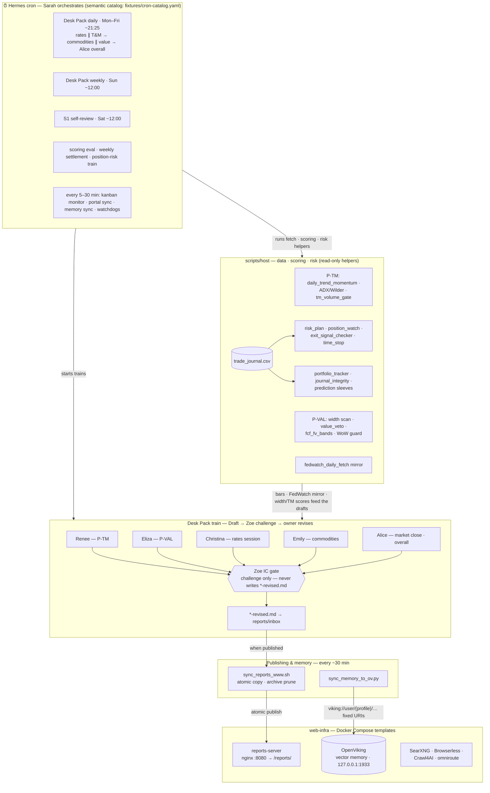
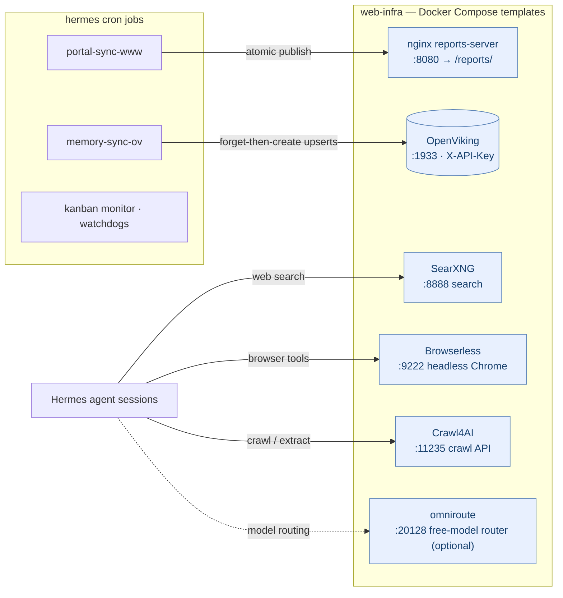

# Helios @ Hermes — Multi-Specialist Investment Desk

An open, research-oriented **multi-agent investment desk** that runs for Herm(e)s-style agent gateways: trend/momentum (P-TM), value/valuation-width (P-VAL), rates (Christina), commodities (Emily), and a macro integrator (Alice), coordinated by an orchestrator (Sarah) with an independent challenge gate (Zoe).

> **Disclaimer — not investment advice.** Every script here reads journals and market data and writes reports. Nothing places broker orders. All fixtures are synthetic symbols (`TST1.L`, `ACME`, `BETA`). Use at your own risk.

## Highlights

- **Draft → Challenge → Revise → Publish** pipeline: specialists draft, Zoe (the challenge gate) critiques, the owner revises (`*-revised.md`), and the outcome lands in a public nginx reports portal.
- **Prompt/gate machinery**: deterministic completion and revised-gate scripts validate desk-pack artifacts before promotion — clone checks, age checks, exit receipts.
- **Trading-adjacent analytics**: Wilder ADX/ATR indicator cores, volume gates, value veto overlays, Kelly-style sizing trains, drawdown monitors, SL/TP excursion ledgers.
- **Memory**: per-profile `MEMORY.md` mirrored into OpenViking (vector memory) every 30 minutes.
- **Web infrastructure as templates**: Docker Compose for a reports server, OpenViking, SearXNG, Browserless, and Crawl4AI — all secrets via placeholders.

## Quickstart

```bash
git clone https://github.com/<you>/helios-hermes-ai-agent.git
cd helios-hermes-ai-agent

# 1) Bring up infra (templates — fills secrets from .env)
cp .env.example .env            # fill placeholders
docker compose -f web-infra/... up -d   # see docs/INSTALL.md

# 2) Install assets into $HERMES_HOME
# 3) Seed crons from docs/cron-catalog.md
# 4) Smoke-test
python3 -m pytest scripts/tests -q
./scripts/run-equity-sleeve-audits.sh
./profiles/desk/tests/run_desk_audit.sh
```

Full guide: **[`docs/INSTALL.md`](docs/INSTALL.md)**

## How the desk works

**Agent roles** (`profiles/`):

| Profile | Function |
|---------|----------|
| **Sarah** (orchestrator) | Cron / Kanban owner; starts Desk Pack trains |
| **Alice** | Macro integrate, market close / desk overall, social watcher |
| **Christina** | Rates session — FedWatch is **consume-only** |
| **Emily** | Commodities session |
| **Renee** | P-TM — trend/momentum scores, daily/weekly narrative |
| **Eliza** | P-VAL — valuation width, value session |
| **Zoe** | IC challenge gate + data QA — never writes `*-revised.md` |

**Key invariants:**
- **E5 rule** — never blend `tm_score` (P-TM) and `valuation_score` (P-VAL) in one number; a ticker appearing in both packs is a WARN, not an error.
- Zoe's verdicts are advisory; she challenges but does not overwrite drafts (except the MOA-publish gate, where blend → REWORK).

**Typical schedules** (UTC):

| Function | When |
|----------|------|
| Desk Pack **daily** | Mon–Fri ~21:25 |
| Desk Pack **weekly** | Sun ~12:00 |
| Saturday **S1** self-review | Sat ~12:00 |
| Federated memory → OpenViking | every 30 min |
| Inbox → reports portal | every 30 min |

Semantic catalog: [`docs/cron-catalog.md`](docs/cron-catalog.md), machine-readable: [`fixtures/cron-catalog.yaml`](fixtures/cron-catalog.yaml).

## Architecture

### Desk flow



### Runtime infrastructure



<details>
<summary>Text-only fallback</summary>

```text
        ┌─────────────────────────────────────────────┐
        │ Hermes cron — Sarah orchestrates            │
        │ daily/weekly packs · scoring · risk · syncs │
        └───────────────┬─────────────────────────────┘
                        │ starts trains
   data & scoring       ▼
   (scripts/host)   ┌──────────────────────────────────────────┐
   market data  ───▶│ Draft (Renee·Eliza·Christina·Emily·Alice)│
   FedWatch ───────▶│        │                                 │
   journal ────────▶│        ▼                                 │
                    │  Zoe IC gate (challenge only)            │
                    │        │                                 │
                    │        ▼                                 │
                    │  *-revised.md → reports/inbox            │
                    └────┬───────────────────────────┬─────────┘
                         │                           │
            sync_reports_www.sh (30m)       sync_memory_to_ov.py (30m)
                         ▼                           │
              nginx reports-server :8080      OpenViking memory
              → /reports/ portal              viking://user/<profile>/...

   sidecars: SearXNG · Browserless · Crawl4AI (search / browser / crawl)
```

</details>

## What's in each folder

| Path | Contents |
|------|----------|
| [`scripts/host/`](scripts/host/) | Python generators, risk/journal/position helpers, desk-pack gates, sync scripts |
| [`scripts/tests/`](scripts/tests/) | Offline pytest suite (459 tests, no network, no secrets) |
| [`profiles/`](profiles/) | SOUL/skills contracts per agent + fixture-based audit runners |
| [`web-infra/`](web-infra/) | Docker Compose templates: reports-server (nginx + :8080), OpenViking, SearXNG, Browserless, Crawl4AI, optional OmniRoute |
| [`docs/`](docs/) | Install, cron catalog, artifact contracts, SL/TP audit, scoring, memory, glossary, failover |
| [`fixtures/`](fixtures/) | Machine-readable cron catalog |

## Requirements

- Python 3.11+ for host scripts and the test suite (`pytest`) — Python ≥3.13 is recommended
- Docker Compose for [`web-infra/`](web-infra/)
- An existing Hermes-compatible gateway — this pack does **not** bootstrap MCP/gateway wiring
- **No secrets are required to run the tests or audits**

## Module map (`scripts/host/`)

| Area | Modules |
|------|---------|
| Desk-pack prompts & gates | `desk_pack_*_train_prompts.py`, `desk_pack_*_gate.py`, `pack_meta_stamp.py` |
| Trend/momentum (P-TM) | `renee/daily_trend_momentum.py`, `adx_wilder.py`, `tm_score_publish.py`, `tm_volume_gate.py`, `backtest/*` |
| Value/width (P-VAL) | `value_veto.py`, `value_ic_tracker.py`, `fcf_fv_bands.py`, `width_publish_guard.py`, `validate_wow_diff.py` |
| Risk/positions/exits | `risk_plan.py`, `position_watch.py`, `exit_signal_checker.py`, `time_stop.py`, `vol_corr_size.py`, `excursion_ledger.py` |
| Portfolio/journal | `portfolio_tracker.py`, `journal_integrity_check.py`, `sleeve_paper_book.py`, `prediction_emit.py`, `prediction_settler.py` |
| Scoring overlays | `scoring_eval_daily.py`, `scoring_eval_weekly.py` |
| Rates/market data | `fedwatch_daily_fetch.py`, `market_data.py` |
| Decide/MOA gates | `mercury_decide.py`, `moa_rework_gate.py`, `four_path_auto_derive_gate.py`, `pit_checklist.py` |
| Memory & portal sync | `sync_memory_to_ov.py`, `sync_reports_www.sh` |
| Zoe ops | `zoe_tracker.py` / `.sh` |

### Memory function

Local per-profile `MEMORY.md` stays the agent scratchpad; [`sync_memory_to_ov.py`](scripts/host/sync_memory_to_ov.py) mirrors each file into OpenViking under:

`viking://user/<profile>/peers/hermes/memories/patterns/mem_LOCAL_MEMORY_<profile>.md`

(forget-then-create; requires `OPENVIKING_API_KEY`). Details: [`docs/MEMORY.md`](docs/MEMORY.md).

## Docs index

- [`docs/INSTALL.md`](docs/INSTALL.md) — end-to-end install
- [`docs/desk-artifact-contracts.md`](docs/desk-artifact-contracts.md) — artifact IDs and gates
- [`docs/SL-TP-AUDIT.md`](docs/SL-TP-AUDIT.md) — stop/target policy and audit
- [`docs/SCORING-ENHANCEMENTS.md`](docs/SCORING-ENHANCEMENTS.md) — overlay scoring
- [`docs/MEMORY.md`](docs/MEMORY.md) — OpenViking memory sync
- [`docs/failover-concept.md`](docs/failover-concept.md) — model failover (vendor-neutral)
- [`docs/glossary.md`](docs/glossary.md) — shared desk vocabulary

## Tests

```bash
python3 -m pytest scripts/tests -q          # 459 tests, <1s, fully offline
./scripts/run-equity-sleeve-audits.sh        # profile audits Alice/Eliza/Renee
./scripts/run-desk-audits.sh                 # Emily / Christina / desk audit harness
./profiles/desk/tests/run_desk_audit.sh
```

## What this repo does NOT contain

| Included here | Stays on your host only |
|---------------|-------------------------|
| Desk docs, SOUL/skills, workflow YAML | Live cron UUIDs / `jobs.json` |
| `scripts/host/` finance + sync helpers | Real API keys, Telegram chat IDs |
| `web-infra/` Compose **templates** | Filled `ov.conf` / service `.env` |
| Semantic cron catalog | Foreign host job IDs |
| Synthetic pytest fixtures | Live holdings |

- No broker-connectable code, live order placement, or real P&L
- No author host paths — everything is overridable via `HERMES_HOME`-relative paths and env vars

## License

MIT — see [`LICENSE`](LICENSE).
